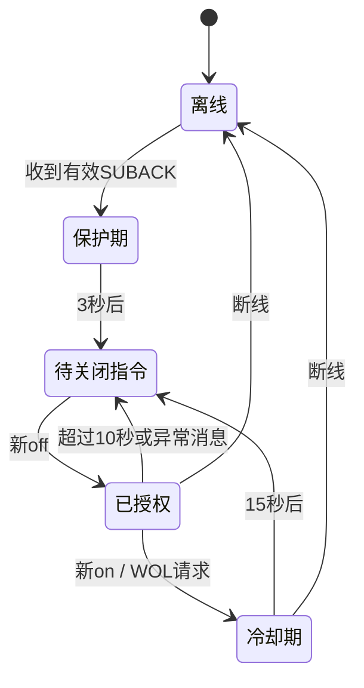

# 设计说明

补充：2026-11-04用户授权后已确认MQTT主题并完成本机真实账号测试，见[真实云端验证](真实云端验证.md)。以下研究过程描述保留首轮日期。

日期：2026-11-03。范围：无硬件第一阶段软件开发。台式机为 Ryzen 7 9700X / ROG STRIX B850-G GAMING WIFI / Windows，有线接家庭路由器；开发笔记本不是目标。用户随后确认购买 ESP32-C3 SuperMini（商品标注 4MB Flash、Type-C、未焊排针）。

## 官方资料结论

| 资料 | 本项目使用的结论 |
|---|---|
| [文档首页](https://cloud.bemfa.com/docs/) | 云提供 TCP / MQTT / 设备 API |
| [MQTT](https://cloud.bemfa.com/docs/src/mqtt.html) | MQTT 3.1.1；bemfa.com:9501 / TLS:9503；支持 QoS0/1、Retain，不用 QoS2 |
| [TCP](https://cloud.bemfa.com/docs/src/tcp.html) | 8344，键值对、CRLF；cmd=1 只订阅，cmd=3 订阅并拉历史；60 秒心跳、65 秒超时；第一版未实现 TCP |
| [设备类型](https://cloud.bemfa.com/docs/src/index_device.html) | 末三位决定 APP 类型，006 为开关、001 为插座；已有主题保持原样 |
| [设备 API](https://cloud.bemfa.com/docs/src/api_device.html) | type=1 是 MQTT、type=3 是 TCP；在线查询 `/va/online` 判断云连接，不是电脑开机状态 |
| [平台操作](https://cloud.bemfa.com/docs/src/index_guild.html) | 控制台 UID 为私钥，主题值区别于昵称 |
| [esp32dev](https://docs.platformio.org/en/latest/boards/espressif32/esp32dev.html)、[Espressif32](https://docs.platformio.org/en/latest/platforms/espressif32.html) | 保留已验证 6.12.0 / 2.0.17；经典 ESP32 基线与 C3 分开构建 |

本次只访问公开文档与无凭据 TLS 握手；没有访问用户巴法云账号，没有创建、删除、转换主题，也未查询包含真实 UID 的 API。

### 认证、订阅与状态

按官方方式一，将 **UID 原样作为 MQTT Client ID**，不使用随机 ID，不额外传用户名/密码。方式二支持 appID/secretKey，但本版不实现，避免混淆认证方式。同一 UID / Client ID 若被其他 MQTT 设备或调试器复用，可能互踢；多设备场景需先向平台确认采用方式二的配置方案。本版只用于一个常通电 ESP32。

订阅既有基础主题，不订阅 `主题/set` 或 `主题/up`。官方 `/set` 用于推送给其他订阅者、排除发布者自身；`/up` 只更新云数据、不推送。本版 **完全不向控制主题发布状态**，所以不会把本机状态回显当作开机命令，也不会主动改写保留状态。APP 开关位置只表示主题状态；其显示为开或关不证明电脑电源状态。官方客户端的实际开关消息格式在到货后需逐项验证，固件只接受严格小写 `on` / `off`。

clean session=true，订阅 QoS0，收到 SUBACK 且授予 QoS0 才进入在线状态；不主动请求离线消息或历史。QoS0 可能丢消息，点击没有响应时须查看串口并重做 off/on，不会积攒指令等待网络恢复。

## 开源项目审阅与取舍

主要参考工程审阅提交：`1d9cd4df471a179daf2b4f33b8b7fb68df1d1bda`。

- `src/bemfa_client.hpp` 使用 `WiFiClient` + TCP 8344，并非 MQTT。1 秒重连、60 秒心跳，`send()` 打印含 UID 的完整订阅字符串；本项目删除这种日志方式。
- 原工程按 200ms 无新字节判断整条指令，而不是可靠的 CRLF 分帧；一次读一字节、字符串截取没有严格验证主题和字段。新版本使用标准 MQTT 解包、精确主题及长度检查。
- `src/main.cpp` 把 Wi-Fi/UID/MAC 常量写在业务代码中；没有启动防历史或冷却策略，LED 闪灯多次 delay。本项目配置独立、定时发送、不控制 LED，也无需 Web/AsyncTCP。
- 原工程 platformio.ini 平台版本没有固定；README 所列 ESPAsyncWebServer/AsyncTCP 对本任务无必要，本项目不引入。
- WakeOnLan 库提供 MAC 解析、广播计算、重发；其重发循环用 delay，部分格式解析较宽。本项目自行实现固定数组 WiFiUDP：依赖更少，可对同一生产代码做原生测试；代价是自行承担维护和验证，本次已覆盖这些路径。

### MQTT 库选择

先评估了 [PubSubClient](https://github.com/knolleary/pubsubclient)：默认缓冲 256 字节、keepalive 15 秒，支持 Arduino Client/TLS，发布只支持 QoS0；回调不暴露 Retain/DUP，且上游 2026 年声明停止维护。另查看 256dpi/MQTT，其公开回调也未直接暴露本任务所需元数据。最终固定 [ArduinoMqttClient 0.1.8](https://github.com/arduino-libraries/ArduinoMqttClient/tree/0.1.8)：支持流式读取、Retain、QoS 与 SUBACK。

审阅中发现 0.1.8 源码 `_rxFlags=b&0x0f` 后却用 `0x80` 判断 DUP，无法正确读出 DUP。**本项目不依赖该方法，不修改上游依赖**：`ObservedClient` 在解密后的 Client 读取边界观察 MQTT 固定报头，`MqttFrameTracker` 从正确的 `0x08` 位提取 DUP，并读取 Retain `0x01`。原生测试实际输入 0x30/31/38/39 报头、分片、多个数据帧及异常长度。元数据在读取负载前捕获，避免解析器换帧。入站帧剩余长度最多 512 字节，超限关闭连接；业务负载最多 3 字节，完全不打印原始内容。

## TLS

默认 `Transport::Tls`，bemfa.com:9503。公开根证书 `Certum Trusted Root CA` 从本机 Mozilla/certifi 信任库提取，根有效期 2018-03-16 至 2043-03-16；SHA256 指纹详见 `evidence/root-ca.txt`。没有信任未知自签证书，也没有跳过证书校验。

本次通过本机 7897 代理对 **TLS1.2 + SNI bemfa.com + verify_hostname bemfa.com + verify_return_error** 做无凭据探测。链和主机名校验通过，密码套件 ECDHE-RSA-AES128-GCM-SHA256；见 `evidence/tls-probe.txt`。此证据只证明开发机探测时的服务器条件，不证明 ESP32 mbedTLS 已实机握手。固件用 `WiFiClientSecure.setCACert` 并按域名连接，启动时先用 SNTP 获取有效时间；时间不足、证书到期、域名不匹配或根变化均连接失败，绝不切换到 9501。SNTP 本身非认证时间来源，网络错误时间可能令 TLS 失败，需实机检查。

显式开发替代：只有同时选择 `PlaintextDevelopment` 且 `allowPlaintext=true`，才用 9501，并在串口明确警示 UID/消息明文。默认不启用。根更换时应重新核验链、更新公开 CA、USB 重刷，不应关闭校验。

另用 `tools/check_tls.py --proxy 127.0.0.1:7897`，只加载**固件同一张根证书**，固定TLS1.2、P-256和ECDHE-RSA-AES128-GCM-SHA256，再次通过主机名/证书校验，见 `evidence/tls-firmware-root.txt`。探测时服务器叶证书有效期为2025-10-11至2026-11-10；这不是根证书的有效期。到货后若已接近/超过该日期且TLS失败，先复测平台证书续期和设备时间；根不变且平台正常续证时无需换固件，不能跳过验证。

## 任务分工与重连

主循环管理 Wi-Fi 与 WOL。Wi-Fi STA 模式、关闭凭据持久化，每 15 秒重试，不用 while 等待连接。成功打印 IP/网关/掩码，不打印 SSID/密码/UID/MAC。

云任务单独运行在 FreeRTOS 中，栈预留 8192 字节，仅该任务访问 MQTT/TLS 对象。TCP connect 目标超时 3 秒、TLS handshake 5 秒、MQTT ACK 2 秒；DNS/底层调用仍可能更久，隔离到独立任务避免卡住主循环，不能声称所有网络操作完全异步或总耗时严格为某一个上限。每次失败退避最高 60 秒，成功后回到 5 秒基准；30 秒 MQTT keepalive 由库维护。断线后重新 SUBSCRIBE。

队列容量 8，消息携带接收时间和连接代号；主循环丢弃旧代号、离线和等待超过 2 秒的消息。队列溢出采用断线撤销授权策略。无线中断或子网变化会取消未发完的 WOL 包，网络恢复不补发。

## 指令状态机与限制

1. `on` 和 `off` 长度必须恰好 2/3，逐字节小写匹配；空格、大小写、嵌入 NUL、包含 on 的其他字符串均无效。
2. Retain/DUP 不触发也不授权；SUBACK 前全部丢弃；重连后 3 秒保护期内全部丢弃。
3. 保护期后，用户先发送新的非保留 `off`，10 秒内发送新的 `on`；每次请求消耗授权。`off` 不执行关机。无效/重复/保留消息会撤销已有授权。
4. 从接受唤醒请求开始冷却 15 秒。冷却中 off/on 都不排队，结束后重新 off/on。冷却跨 MQTT 重连保留；完整 ESP32 断电重启后冷却内存清空，但重新授权和保护期仍存在。时间计算处理 millis 约 49.7 天回绕。
5. UDP 失败也消耗本次授权和冷却，避免失败时消息风暴；等待后重做 off/on。

标准 MQTT 订阅时回放的 Retain=1 历史 on 能被明确拒绝。但云如果把历史状态当作新的非保留消息下发，或有人完整重放旧的 off/on，纯 on/off 没有认证时间和命令 ID，仍无法完全区分。若 APP 每次下发都标记 Retain=1，本版会全部拒绝，应先实机确认其行为，不能为了让点击生效就移除过滤。

现有官方 APP 兼容的保守防护是本版的短窗口 off/on 操作；可在实测 `/up` 语义后由用户决定是否增加“只更新云显示”的 off 复位，当前未自动操作。严格防重放需要服务端签发短时 nonce / 单调命令 ID、认证时间窗和持久化去重记录，消息如 `wake:id:time:mac`，并由官方客户端支持相应自定义消息或可信中间服务。普通开关 UI 单独无法实现这一保证；本版不引入额外 App、服务器或新主题。

## WOL

固定 102 字节数组：6×FF + 16×6 字节 MAC，接受冒号/连字符统一分隔或 12 位紧凑十六进制，拒绝零地址、广播、多播、混用分隔符及尾部垃圾。

数值统一为网络字节序，广播 `ip | ~mask`；验证掩码连续、IP 可用，支持 /23、/28 等非 /24。手动广播必须等于当前子网广播或 255.255.255.255，避免误向其他网段发送。默认 UDP9、3包、100ms间隔，逐个检查 beginPacket/write/endPacket。

ESP32 Wi-Fi 与台式机以太网需处于能转发广播的同一 LAN，不能是隔离访客网。WOL 无确认协议，日志只能说明本地 UDP 发送结果。主板固件、网卡驱动及关机状态是否支持唤醒，必须到货后在家中逐项实测。
